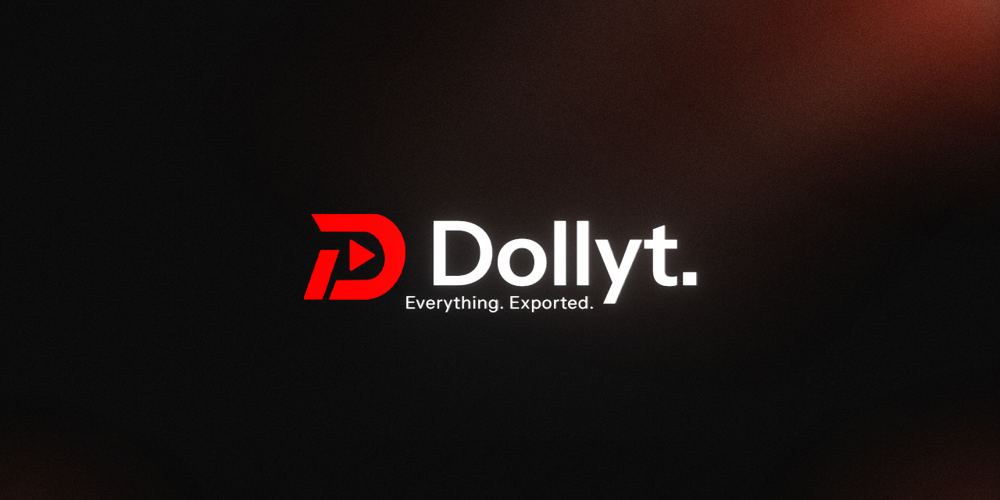

<div align="center">
  
  
  <br>
  <b>Everything. Exported.</b>
  <br><br>
  <a href="https://github.com/zFusions/Dollyt/releases"></a>
  <a href="https://github.com/zFusions/Dollyt/blob/master/LICENSE"></a>
  <a href="https://github.com/zFusions/Dollyt/actions/workflows/ci.yml"></a>
</div>

## About

Dollyt is a desktop YouTube clip exporter for Windows. Paste a URL, choose a preset, select a range, and export — everything stays on your PC. No cloud upload, no Dollyt server, no telemetry.

## Quick Start

1. Download the [latest Windows installer](https://github.com/zFusions/Dollyt/releases/latest).
2. Run the installer (WebView2 Runtime is required).
3. Paste a YouTube URL and export.

## Features

- **Local preview** — See the video in-app before exporting.
- **Precise selection** — Timeline with start/end time controls.
- **Presets** — TikTok, Reels, Shorts, YouTube, X formats.
- **FFmpeg encoding** — Optional hardware encoding (NVENC).
- **History** — Re-export from your past exports.
- **Privacy** — All processing is local; no Dollyt telemetry.
- **Bilingual** — French and English interface.

## Screenshots

*(Captures à venir — la démo et les screenshots seront ajoutés prochainement.)*

## Usage

1. Paste a YouTube URL.
2. Choose a preset and select a range.
3. Export the clip.
4. Open the result from the completion screen or the History page.

Dollyt supports French and English. The first launch follows the system language when it is supported; a manual choice is persisted locally.

## Requirements

- Windows 10 version 1809 or later, or Windows 11 (x64).
- WebView2 Runtime.
- Rust stable and the Tauri prerequisites for source builds.
- Node.js and npm.

yt-dlp is downloaded from an official pinned GitHub release and verified with SHA-256 before use. On first launch, FFmpeg, ffprobe and Deno are downloaded from pinned official releases and verified with SHA-256 into `%LOCALAPPDATA%\Dollyt\bin`. An internet connection is required for this one-time setup.

Runtime tool licenses and sources are listed in [THIRD_PARTY.md](THIRD_PARTY.md).

## Build from source

```powershell
npm install
npm run tauri dev
```

For a release build:

```powershell
npm run tauri build
```

The generated executable and installer are written below `src-tauri\target\release`.

## Development

```powershell
npm run typecheck
npm run build
npm run test:e2e
cargo test --manifest-path src-tauri\Cargo.toml --locked
cargo clippy --manifest-path src-tauri\Cargo.toml -- -D warnings
cargo fmt --manifest-path src-tauri\Cargo.toml -- --check
```

## Architecture

The React frontend owns navigation, transient editor state and the local history view. Tauri commands provide a narrow boundary to the Rust backend. Rust validates YouTube URLs, invokes yt-dlp, performs FFmpeg processing and emits progress events. Settings and presets live in `%LOCALAPPDATA%\Dollyt`; temporary previews and filmstrips live in the user temporary directory.

See [docs/INFRA.md](docs/INFRA.md) for the current data-flow map.

## Privacy and legal notice

Dollyt does not provide a Dollyt server, telemetry or account system. Network traffic is made to YouTube/googlevideo for media work and GitHub for the pinned yt-dlp release. Use the software only with content you are allowed to download and process. Dollyt is not affiliated with YouTube and does not bypass DRM.

## Contributing

Keep changes focused, add a regression test for behavior changes, and run the validation commands above before opening a pull request. Do not commit credentials, cookies, local paths or generated build artifacts.

## License and branding

The source code is available under the MIT License. See [LICENSE](LICENSE).

The Dollyt name and logo are not granted for use as the identity of a fork; see [TRADEMARKS.md](TRADEMARKS.md). Forks must use distinct branding and identify themselves as independent projects.
