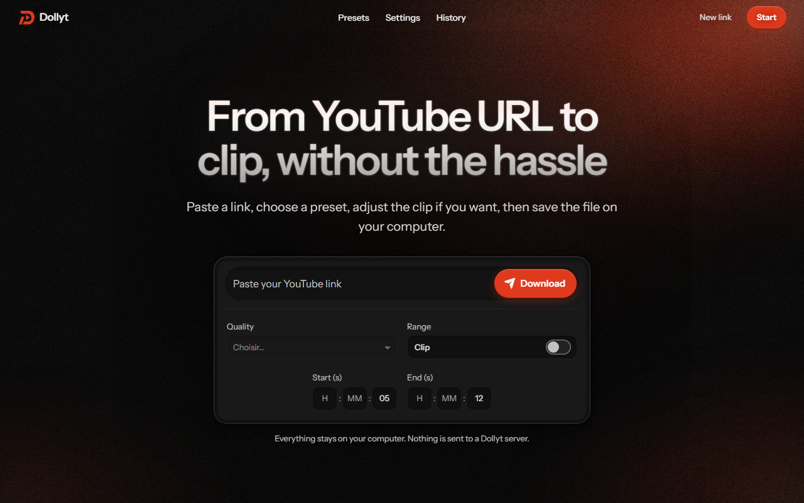
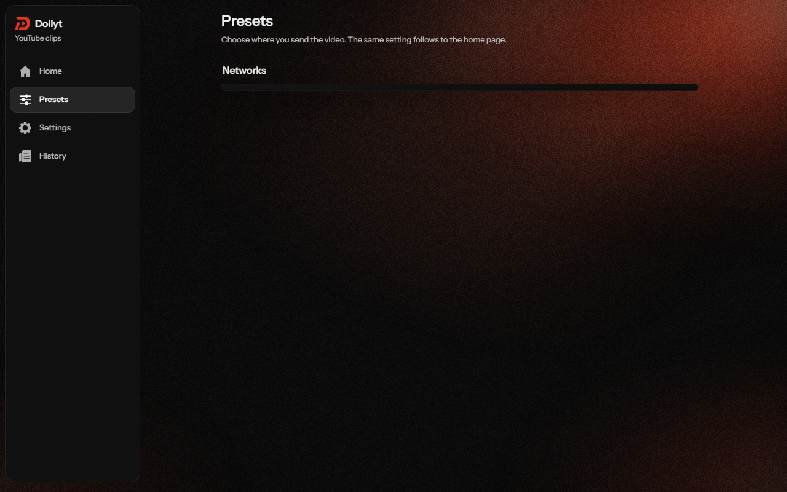
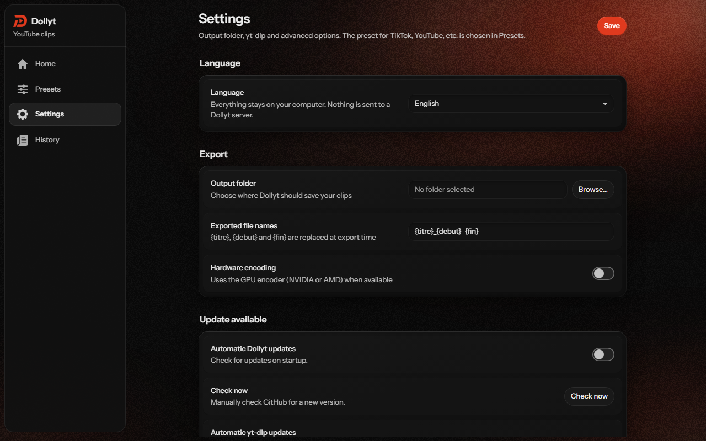
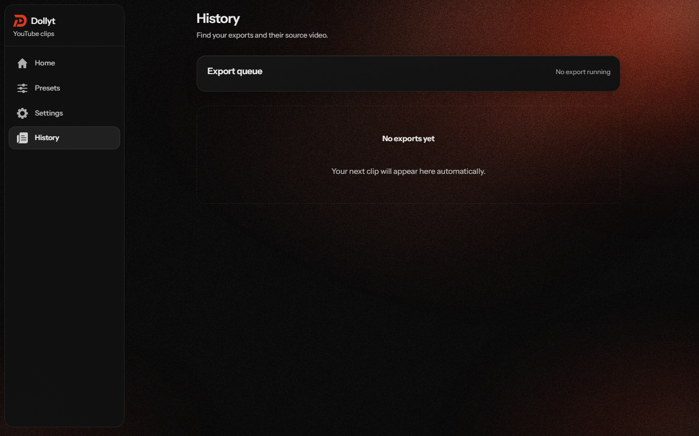

<p align="center">
  
</p>

<h1 align="center">Dollyt</h1>

<p align="center">
  <em>Paste a link. Pick a format. It's on your disk before the ad break ends.</em>
</p>

<p align="center">
  
  
  
  
  
</p>

<p align="center">
  
</p>

<p align="center">
  <strong>Local. Fast. Yours.</strong><br>
  A desktop YouTube clip exporter that never uploads a byte to a Dollyt server.<br>
  <sub>yt-dlp for extraction, FFmpeg for encoding, Tauri + React for the interface.</sub>
</p>

---

## What it does

| | |
| --- | --- |
| **Paste** | Any YouTube URL — clip or full video |
| **Pick** | TikTok 9:16, Reels, Shorts, YouTube 16:9, X, raw source, local quality, max quality, MP3 320k or lossless FLAC |
| **Queue** | Stack exports — they run one at a time in the background while you keep working (or play Snake) |
| **Get** | The file lands in your folder; preview it in-app, re-open it from History |

## Features

- **Local preview** — watch the video in-app before exporting
- **Export queue** — multiple jobs, live progress per job, per-job cancel
- **Audio exports** — MP3 320k or FLAC lossless, with a custom audio player
- **FFmpeg encoding** — optional hardware encoding (NVIDIA NVENC or AMD AMF)
- **History** — every export saved locally, re-open or re-export anytime
- **Snake** — a tiny game that keeps you company during long exports, with a persistent high score
- **Bilingual** — French and English, switches instantly
- **Privacy** — all processing is local; no telemetry, no account, no Dollyt server

## Screenshots

<p align="center">
  <br>
  <sub>Home — paste, pick a preset, go</sub>
</p>

<p align="center">
  <br>
  <sub>Presets — grouped by network, format badge, details below</sub>
</p>

<p align="center">
  <br>
  <sub>Settings — output folder, cookies, updates, developer mode</sub>
</p>

<p align="center">
  <br>
  <sub>History — past exports plus the live export queue</sub>
</p>

## Quick start

1. Download the [latest Windows installer](https://github.com/zFusions/Dollyt/releases/latest) and run it (WebView2 Runtime required).
2. On first launch, FFmpeg, ffprobe, yt-dlp and Deno are downloaded from pinned official releases and verified with SHA-256.
3. Paste a YouTube URL, pick a preset, export.

## Requirements

- Windows 10 1809+ or Windows 11 (x64), WebView2 Runtime
- Rust stable + Tauri prerequisites, Node.js and npm — for source builds only

Runtime tool licenses and sources: [THIRD_PARTY.md](THIRD_PARTY.md).

## Build from source

```powershell
npm install
npm run tauri dev
```

Release build:

```powershell
npm run tauri build
```

Output lands in `src-tauri\target\release`.

## Development

```powershell
npm run typecheck
npm run build
npm run test:e2e
cargo test --manifest-path src-tauri\Cargo.toml --locked
cargo clippy --manifest-path src-tauri\Cargo.toml -- -D warnings
cargo fmt --manifest-path src-tauri\Cargo.toml -- --check
```

The React frontend owns navigation, editor state and history. Tauri commands form a narrow boundary to the Rust backend: URL validation, yt-dlp extraction, FFmpeg processing, progress events. Settings and presets live in `%LOCALAPPDATA%\Dollyt`. See [docs/INFRA.md](docs/INFRA.md) for the data-flow map.

## Privacy and legal notice

Dollyt has no server, no telemetry and no account system. Network traffic goes to YouTube/googlevideo for media work and to GitHub for the pinned yt-dlp release. Use it only on content you're allowed to download and process. Dollyt is not affiliated with YouTube and does not bypass DRM.

## Contributing

Keep changes focused, add a regression test for behavior changes, and run the validation commands above before opening a pull request. Do not commit credentials, cookies, local paths or generated build artifacts.

## License and branding

Source code under the [MIT License](LICENSE). The Dollyt name and logo are not granted for use as the identity of a fork — see [TRADEMARKS.md](TRADEMARKS.md). Forks must use distinct branding and identify themselves as independent projects.
