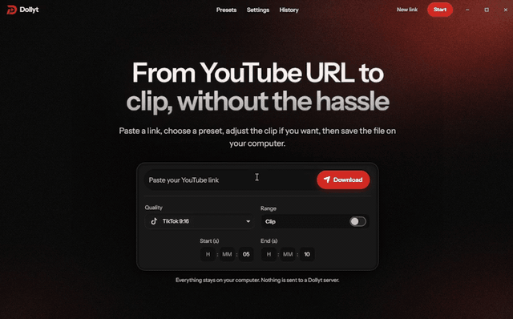

<p align="center">
  
</p>

<h1 align="center">Dollyt</h1>

<p align="center">
  <em>Paste a link. Pick a format. It's on your disk before the ad break ends.</em>
</p>

<p align="center">
  
  
  
  
  
</p>

<p align="center">
  
</p>

<p align="center">
  <strong>Local. Fast. Yours.</strong><br>
  A desktop YouTube clip exporter that never uploads a byte to a Dollyt server.<br>
  <sub>yt-dlp for extraction, FFmpeg for encoding, Tauri + React for the interface.</sub>
</p>

---

## What it does

| | |
| --- | --- |
| **Paste** | Any YouTube URL — clip or full video |
| **Pick** | TikTok, Reels, Shorts (source aspect), YouTube 16:9 with letterboxing, X, raw source, local quality, max quality, MP3 320k or lossless FLAC |
| **Queue** | Stack exports — they run one at a time in the background while you keep working (or play Snake) |
| **Get** | The file lands in your folder; preview completed exports in-app and find them again in History |

## Features

- **Export preview** — preview a completed video or audio export in-app
- **Export queue** — multiple jobs, live progress per job, per-job cancel
- **Audio exports** — MP3 320k or FLAC lossless, with a custom audio player
- **FFmpeg encoding** — optional hardware encoding (NVIDIA NVENC or AMD AMF)
- **Real clip progress** — yt-dlp reports download progress before Dollyt cuts the selected range locally; this can download more data than the clip alone on long videos
- **History** — every completed export is saved locally; open its location or remove its history entry
- **Snake** — a tiny game that keeps you company during long exports, with a persistent high score
- **Bilingual** — French and English, switches instantly
- **Privacy** — all processing is local; no telemetry, no account, no Dollyt server

## Quick start

1. Download the [latest Windows installer](https://github.com/zFusions/Dollyt/releases/latest) and run it (WebView2 Runtime required).
2. The Windows setup installs yt-dlp, FFmpeg, ffprobe and Deno from pinned, SHA-256-verified packages. The first app launch reuses those local files without downloading or rechecking them. If a tool is missing or damaged, Dollyt can recover it from the official GitHub releases.
3. Paste a YouTube URL, pick a preset, export.

## Stability

Dollyt is still rough around export reliability. The same URL and preset can succeed on one Windows PC and fail on another, often when the clip starts far into a long video. Your network, how YouTube serves the file and the bundled yt-dlp or FFmpeg build all matter. Installed builds from Releases are best-effort: no guarantee they behave like a finished product. If an export stalls or errors, try a short range near the start of the video or run a [build from source](#build-from-source) on that PC.

## Requirements

- Windows 10 22H2 or Windows 11 (x64), WebView2 Runtime. Hardware encoding is optional; software encoding works without a dedicated GPU.
- Rust stable + Tauri prerequisites, Node.js and npm — for source builds only

Runtime tool licenses and sources: [THIRD_PARTY.md](THIRD_PARTY.md).

## Build from source

```powershell
npm install
npm run tauri dev
```

Release build:

```powershell
npm run tauri build
```

Output lands in `src-tauri\target\release`.

## Development

```powershell
npm run typecheck
npm run build
npm run test:e2e
cargo test --manifest-path src-tauri\Cargo.toml --locked
cargo clippy --manifest-path src-tauri\Cargo.toml -- -D warnings
cargo fmt --manifest-path src-tauri\Cargo.toml -- --check
```

The React frontend owns navigation, export state and history. Tauri commands form a narrow boundary to the Rust backend: URL validation, yt-dlp extraction, FFmpeg processing and progress events. Settings and user presets live in `%LOCALAPPDATA%\Dollyt`. The timeline editor remains in the source but is quarantined in this release. See [docs/INFRA.md](docs/INFRA.md) for the data-flow map.

## Privacy and legal notice

Dollyt has no server, no telemetry and no account system. Network traffic goes to YouTube/googlevideo for media work and to GitHub for application updates, explicit yt-dlp updates and recovery when a local tool is missing. The setup bundles pinned tool packages verified by SHA-256; yt-dlp self-updates use the latest official GitHub release and validate the reported version because yt-dlp does not sign its binary. Use Dollyt only on content you're allowed to download and process. Dollyt is not affiliated with YouTube and does not bypass DRM.

## Contributing

Keep changes focused, add a regression test for behavior changes, and run the validation commands above before opening a pull request. Do not commit credentials, cookies, local paths or generated build artifacts.

## License and branding

Source code under the [MIT License](LICENSE). The Dollyt name and logo are not granted for use as the identity of a fork — see [TRADEMARKS.md](TRADEMARKS.md). Forks must use distinct branding and identify themselves as independent projects.
